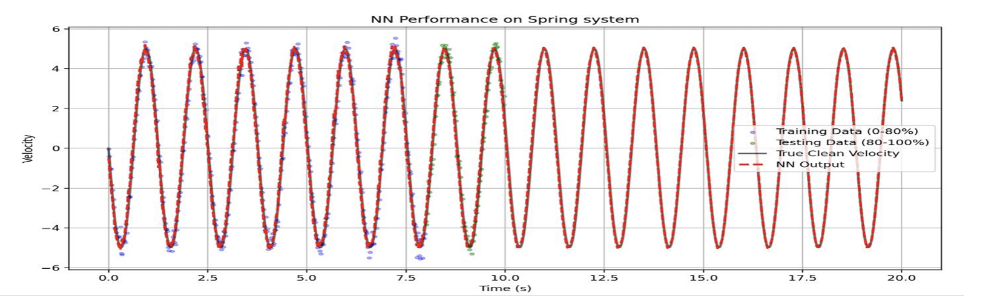
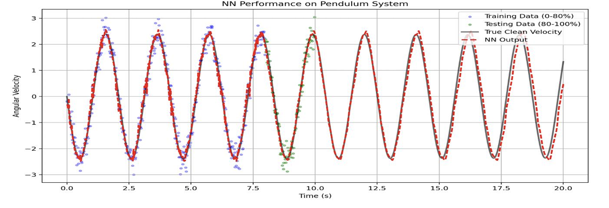
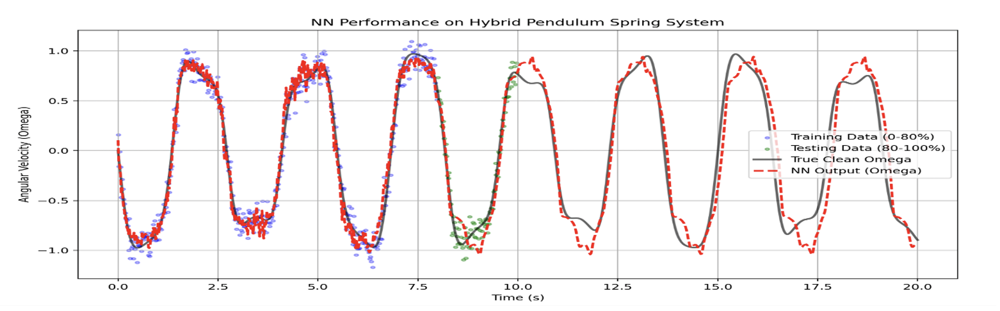

# Physical-Dynamics-Reconstruction-
Deep learning and symbolic regression for reconstructing noisy trajectories and recovering governing physical laws in three mechanical systems. It includes neural network training, autoregressive forecasting, and equation discovery for spring-mass oscillator, pendulum, and hybrid spring-pendulum. 
## Systems Investigated
- Spring-Mass Oscillator
- Nonlinear Pendulum
- Coupled Spring-Pendulum Hybrid System

## Methodology
- Numerical simulation of mechanical trajectories
- Gaussian noise injection
- Feedforward neural network reconstruction
- Unconstrained autoregressive forecasting
- Symbolic regression for governing equation discovery

## Technologies
- Python
- PyTorch
- NumPy
- SciPy
- PySR

## License
This project is licensed under the MIT License.

## Results

### Spring-Mass Oscillator

### Nonlinear Pendulum

### Coupled Spring-Pendulum Hybrid

